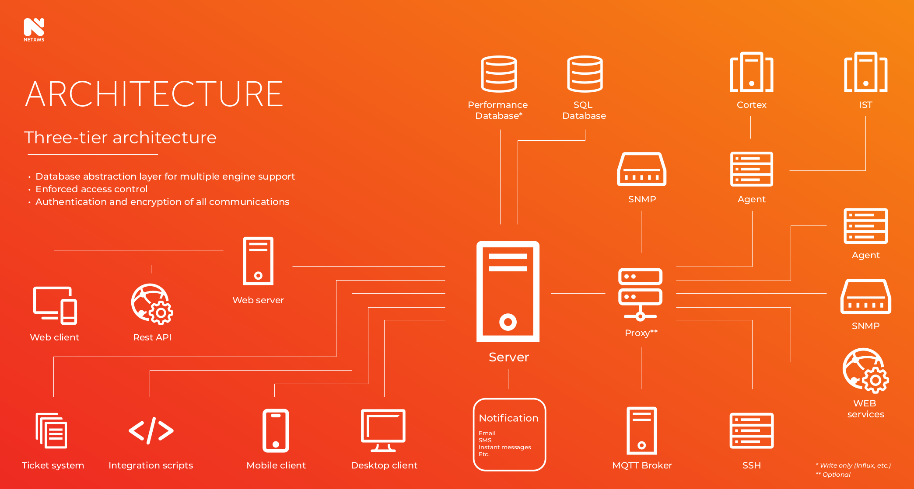

# NetXMS

[](https://github.com/netxms/netxms/actions)
[](https://www.gnu.org/licenses/old-licenses/gpl-2.0.en.html)
[](https://contribute.design/)

NetXMS is an open-source network and infrastructure monitoring and management system. It covers performance and
availability monitoring of network devices, servers and applications, with event processing, alerting, reporting
and graphing.



The system consists of a central management server, monitoring agents, and desktop and web management clients.
Deployments range from a single server to distributed setups with proxy agents in remote zones.

## Features

Network monitoring:

* Network discovery from ARP caches, routing tables, switch forwarding databases, LLDP, CDP and STP
* SNMP v1/v2c/v3, SSH, and web services (XML, JSON, plain text) as data sources
* Lookup of MAC and IP addresses, wireless access points and wireless clients
* Routing tables, MAC tables, VLANs, IP route tracing and network maps built from discovered topology
* Topology-based event correlation
* Vendor-specific device drivers

Server and workstation monitoring:

* Agents for all major operating systems, with centralized configuration and upgrade
* Agent connections in either direction over a single encrypted TCP port, with local caching of collected data when
  the server is unreachable
* Agents can proxy for other agents and SNMP devices
* Log file monitoring
* System, process, network, I/O and hardware sensor metrics; custom metrics via external commands and scripts
* Remote desktop, file transfer and command execution
* User support agent with configurable actions and screenshots

Distributed monitoring:

* Zones with overlapping address space, served by one or more proxy agents with load balancing and failover
* Proxies continue data collection while the server is unavailable
* Syslog and SNMP trap reception at proxies

Event processing and alerting:

* Event processing policy with alarm creation and termination, script and command execution, and escalation
* Notifications via email, Microsoft Teams, Slack, Telegram, Mattermost, webhooks and SMS (GSM modem or gateway)
* Thresholds on collected data; templates for applying configuration to groups of nodes
* Business services with availability calculation and downtime history

Scripting and integration:

* NXSL, an embedded scripting language used for data transformation, thresholds, event processing, trap processing
  and hooks
* REST API and Java client library; Grafana integration
* Export of collected data to InfluxDB and ClickHouse
* Jira and Redmine helpdesk integration
* Plugin interfaces for server modules, agent subagents, device drivers and notification channel drivers

Security:

* Authentication against the internal database or LDAP, with passwords, X.509 certificates, smart cards or RADIUS
* Two-factor authentication with TOTP or one-time codes delivered via notification channels
* Fine-grained access control and audit log

## Installation

See the [installation section](https://www.netxms.org/documentation/adminguide/installation.html) of the
Administration Guide for full instructions. Packages and installers for all supported platforms are available on the
[download page](https://www.netxms.org/download/); container images are in the
[netxms/docker](https://github.com/netxms/docker) repository.

### Debian and Ubuntu

The APT repository at http://packages.netxms.org/ provides signed packages for Debian-based distributions.

```bash
wget http://packages.netxms.org/netxms-release-latest.deb
sudo dpkg -i netxms-release-latest.deb
sudo apt-get update
sudo apt-get install netxms-server netxms-dbdrv-pgsql
```

Configure the database connection in `/etc/netxmsd.conf`, then initialize the schema and start the server:

```bash
sudo nxdbmgr init
sudo systemctl enable --now netxmsd
```

### Building from source

See [CONTRIBUTING.md](CONTRIBUTING.md#building-from-source).

When building into a prefix that already contains an installed NetXMS (for example `/usr/local`), run

```bash
make -j$(nproc) install
```

instead of `make` followed by a separate `make install`.

NetXMS internal libraries (`libnetxms`, `libnxdb`, `libnxsrv` and others) are always built together; binary
compatibility between builds is not supported. The Linux linker also searches system library directories, so with an
older version installed under the same prefix it can pick up an installed library instead of the freshly built one,
and the link fails with undefined symbols. The `install` target builds and installs each directory before moving on to
the next, so the new libraries are in place when the binaries that use them are linked.

Alternatively, build into an empty directory (`./configure --prefix=/path/to/empty/dir && make -j$(nproc) install`)
and copy the result to the target system.

## Documentation

* [Administration Guide](https://www.netxms.org/documentation/adminguide/)
* [NXSL reference](https://www.netxms.org/documentation/nxsl-latest/)
* [Data dictionary](https://www.netxms.org/documentation/datadictionary-latest/)
* [Java API](https://www.netxms.org/documentation/javadoc/latest/)
* [Change log](https://github.com/netxms/changelog/blob/master/ChangeLog.md)
* [YouTube channel](https://www.youtube.com/@netxms)

## Support

* [Forum](https://www.netxms.org/forum/index.php)
* [Telegram](https://telegram.me/netxms)
* [Issue tracker](https://github.com/netxms/netxms/issues)
* Commercial support: [Raden Solutions](https://netxms.com/commercial-support)

## Contributing

See [CONTRIBUTING.md](CONTRIBUTING.md) for code contributions and [DESIGN.md](DESIGN.md) for UI and UX design
contributions.

## License

NetXMS components are licensed under the GNU General Public License version 2 or later; most libraries are under the
GNU Lesser General Public License version 3 or later. See [COPYING](COPYING) for the per-component list.
